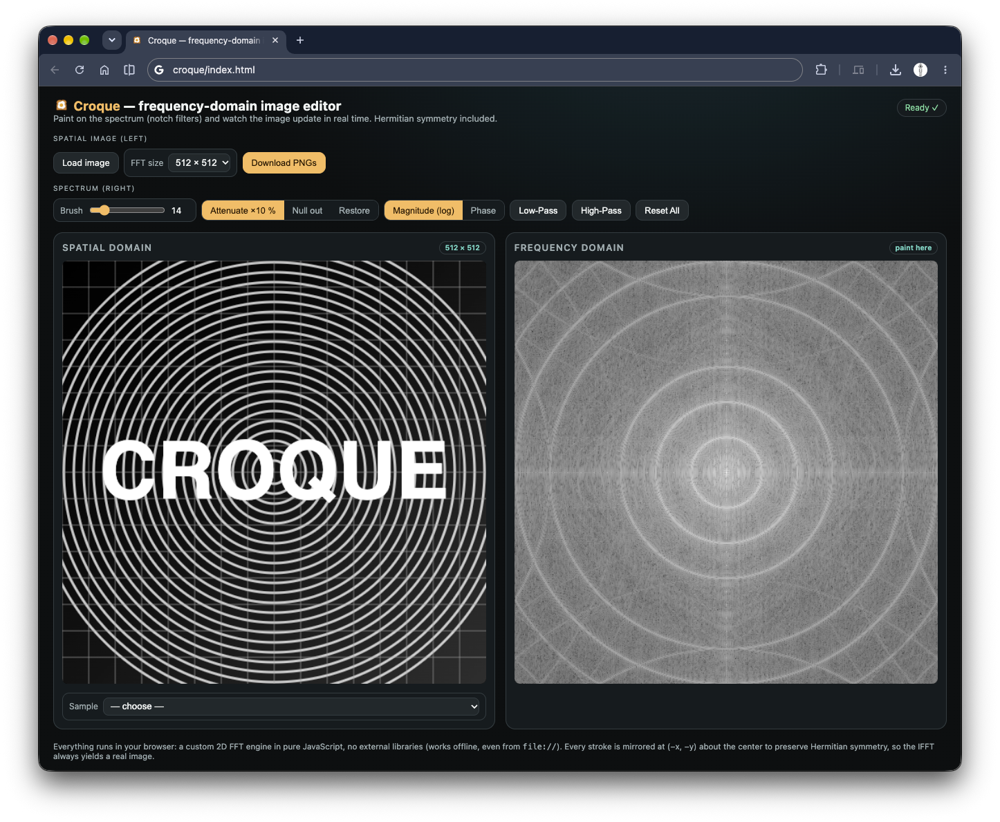
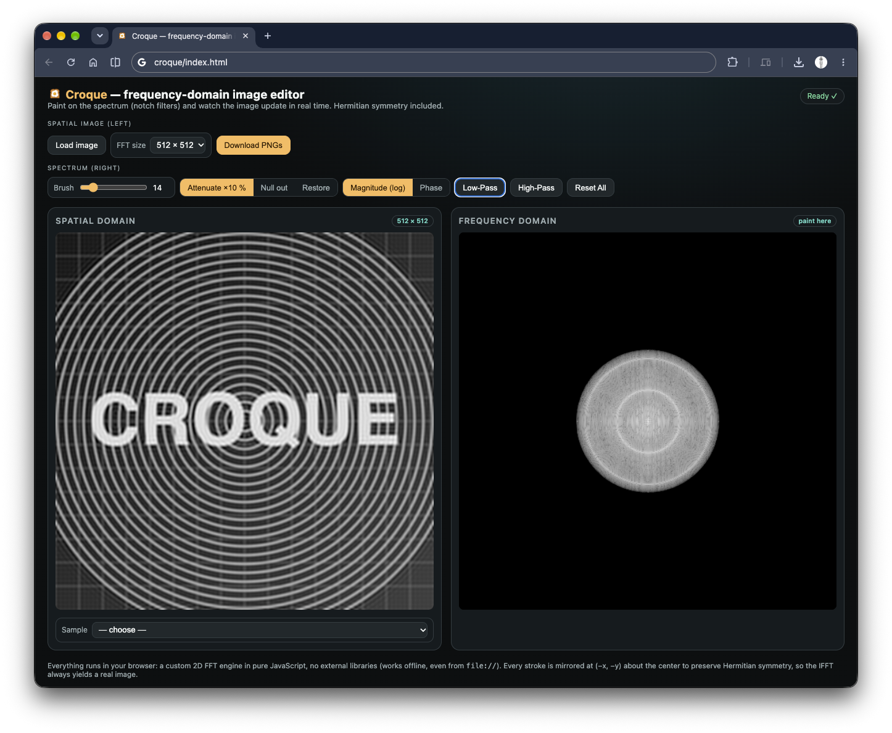
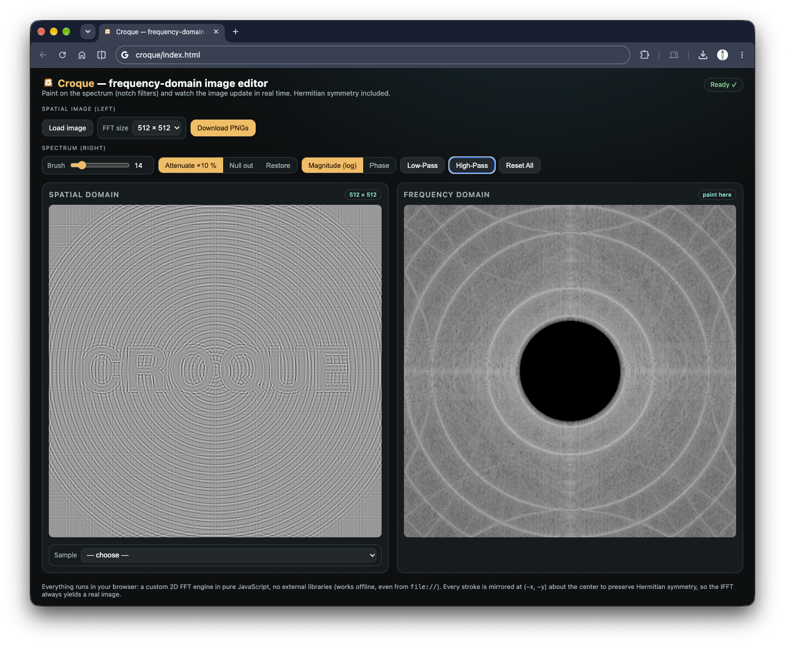
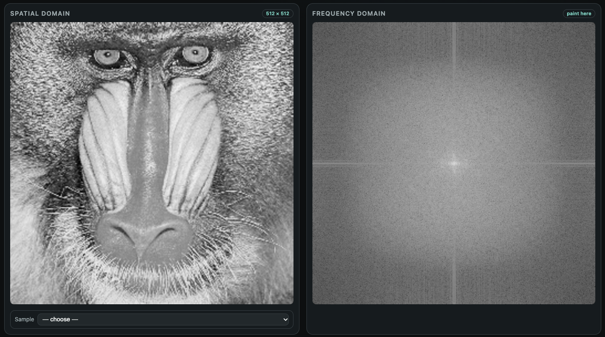
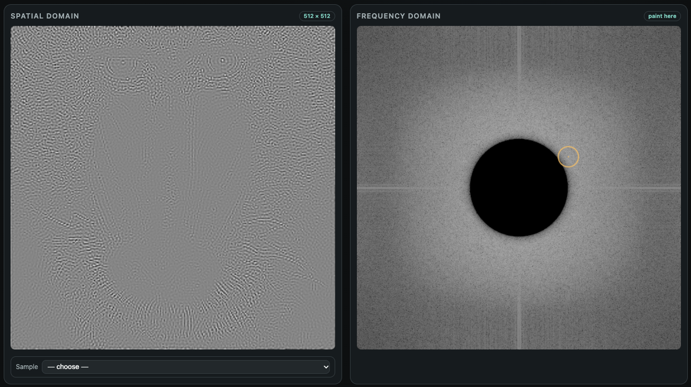

# Croque _[kʁɔk]_

[](LICENSE)
[](index.html)
[](index.html)
[](https://github.com/cuarentaysiete/croque/actions/workflows/test.yml)

A **frequency-domain** image editor for the browser: paint on the spectrum
(notch filters) and watch the color image update in real time.

Single-file lightweight prototype — HTML, CSS and JS all embedded, no frameworks,
no build steps. Everything runs client-side with **HTML5 Canvas** and a **pure
JavaScript FFT engine** (no external libraries).

## How to use

Just open `index.html` in a modern browser (Chrome, Edge, Firefox, Safari).
Optionally serve the folder to avoid `file://` restrictions (needed for the
sample gallery):

```bash
npx serve .
# or
python3 -m http.server 8000
# or, on Chrome/Chromium only: launch with file access allowed, then open index.html
google-chrome --allow-file-access-from-files
```

Only the **sample gallery** needs this: from a `file://` page the browser blocks
`fetch()` and *taints* canvases drawn with `file:` images, so their pixels can
neither be read (FFT input) nor exported (downloads). The **Load image** button
and **drag & drop** use `blob:` object URLs, which inherit the page origin, so
they work fine offline with no server at all.

1. **Get an image in** any of three ways: the **Load image** button,
   **drag & drop** it anywhere on the page, or pick one from the **Sample**
   menu (bottom of the left panel — 18 classic test images from `samples/`).
2. **Paint** on the right canvas (spectrum): the cursor is a circle whose size
   matches the brush; each stroke is **automatically mirrored at
   `(−x, −y)`** about the center (Hermitian symmetry), so the IFFT always
   yields a real image.
3. Tune the **brush size**, pick the **action** (Attenuate ×10 % / Null out /
   Restore, as toggle buttons) and switch the view between **Magnitude (log)**
   and **Phase**.
4. **Low-Pass** / **High-Pass** presets (smooth cosine edge, no ringing),
   **Undo** (Ctrl/Cmd+Z, one step per stroke or preset), **Reset All**, and
   **Download PNGs** — saves *both* domains
   (`croque-spatial.png` + `croque-spectrum.png`).

Keyboard shortcuts: `1`/`2`/`3` select the brush action, `L` low-pass, `H`
high-pass, `R` reset, `Ctrl/Cmd+Z` undo.

Controls are grouped by what they affect: the left cluster works on the source
/spatial image, the right cluster on the spectrum.

## Screenshots


*The full interface with the built-in demo image: spatial domain (left) and centered log-magnitude spectrum (right).*

| Low-Pass preset | High-Pass preset |
|---|---|
|  |  |
| Smooth cosine mask keeps the central disc: the image blurs down to its low-frequency content. | Nulls the central disc: DC and shading are removed, leaving edges and texture. |

| Sample: Mandril | Notch painted next to the High-Pass hole |
|---|---|
|  |  |
| A classic test image from the Sample menu and its raw spectrum. | Brush work on the spectrum (note the circular brush cursor) after a High-Pass. |

## Pipeline

```
color image → RGB→YUV (BT.601)
           → 3× [ 2D FFT (pure-JS Cooley–Tukey) → fftshift ]   (Y, U, V)
           → interactive editing of the Y spectrum (brush + presets)
           → 3× [ ifftshift → 2D IFFT ]                        (Y, U, V)
           → YUV→RGB, min–max on Y → spatial canvas
```

The brush and the presets edit the **Y (luminance)** spectrum; **U and V
(chroma) pass through untouched**, so hue and color are preserved while
structure is filtered. All three channels are transformed together so the
round-trip is an exact color reconstruction.

The FFT resolution (128 / 256 / 512 / 1024) is selectable. The inverse is
computed in a **Web Worker** (an inline Blob worker, so the app stays a single
file) when available, falling back to the main thread otherwise; at 512×512
the worker IFFT runs in a few milliseconds, comfortably real-time.

## Design notes

- **Color via YUV (BT.601)**: the image is split into Y, U, V. The FFT runs
  on all three channels; the brush/presets act on Y only, U/V pass through.
  This keeps hue intact (no color shift from filtering) while letting you notch
  the structure, and the YUV→RGB round-trip is an exact reconstruction.
- **Off-thread inverse FFT**: the ifftshift + 3×IFFT runs in a Web Worker built
  from an inline Blob string (no extra file, no module, works from `file://`).
  Spectra are transferred (not copied) via `postMessage` transferables, and a
  sequence token drops stale results when a faster stroke supersedes one. If
  Workers are unavailable the identical computation runs on the main thread.
- **Undo history**: a snapshot of the Y spectrum is taken once per stroke or
  preset; Undo (Ctrl/Cmd+Z) pops the last. The stack is capped so memory stays
  bounded even at 1024×1024.
- **Hermitian symmetry**: every edit writes the conjugate value to the mirrored
  point `(N−x, N−y) mod N`, keeping the inverse transform strictly real.
- **Log-magnitude display**: `L = 1 + ln(1+|F|) / ln(1+max)`; the phase view
  is a grayscale of the raw phase.
- **Cosine filter edges** in the presets to reduce ringing (Gibbs) artifacts.
- **Cover-crop on load**: non-square sources are scaled to fill the square
  FFT and center-cropped — never stretched.
- **Per-frame brush stamping**: each spectral pixel is edited at most once
  per animation frame, so *Attenuate ×10 %* is a predictable ×0.1 per frame;
  strokes accumulate over time rather than compounding per overlapping disc
  (or double-hitting a pixel and its Hermitian mirror in the same pass).
- **Touch-friendly**: `touch-action: none` on the spectrum canvas (painting on
  a touch device doesn't scroll the page) and strokes tracked by pointer id.
- **No server, no installation, no network** for the core: works offline, even
  from `file://` (only the sample gallery needs a local server).

## Files

| File | Description |
|---|---|
| `index.html` | Complete application (HTML + CSS + JS, self-contained FFT, zero dependencies) |
| `test/` | FFT engine test suite (Node, zero dependencies) |
| `.github/` | CI workflow: runs the test suite on every push and pull request |
| `samples/` | Classic test images for the Sample menu (Cameraman, Lena, Mandril, Peppers, …) |
| `docs/` | Screenshots used in the README (GUI, presets, sample sessions) |
| `icon.png` | App icon and default image |
| `icon.jpg` | Alternative example image (JPEG) |
| `LICENSE` | MIT |

## Testing

The FFT engine is validated by a dependency-free Node test that extracts the
exact engine code from `index.html`, so the tests always exercise what ships:

```bash
node test/fft-test.js
```

It checks five properties: the forward transform against a naive O(N²) DFT,
the inverse round-trip `IFFT(FFT(x)) = x` (including the 1/N² scaling),
Hermitian symmetry of the centered spectrum, a strictly real inverse output,
and 512×512 throughput. The same suite runs automatically on every push via
GitHub Actions (`.github/workflows/test.yml`).

## Limitations

- **Luminance-only editing**: the brush and presets act on the Y channel;
  U/V are passed through unchanged. This is a deliberate choice — it keeps the
  Hermitian-symmetry bookkeeping simple (one edited channel) and preserves
  hue — but it means you can't notch the chroma directly.
- **Power-of-two sizes only** (128 / 256 / 512 / 1024), a requirement of the
  radix-2 engine. 1024×1024 transforms three 1024² channels, so it is ~4×
  slower than 512 and its undo snapshots use more memory.
- **float32 precision**: the inverse is real to within ~1e-5 relative error —
  invisible in the output, but not exact.

## Development

Croque was designed by **cuarentaysiete** and implemented with the assistance
of an AI coding agent: the `pi` agent running a local Qwen3-27B (MLX) model.
The agent wrote the FFT engine, the interface, the test suite and most of this
documentation; the human steered the direction, reviewed every result and
pushed the commits.
