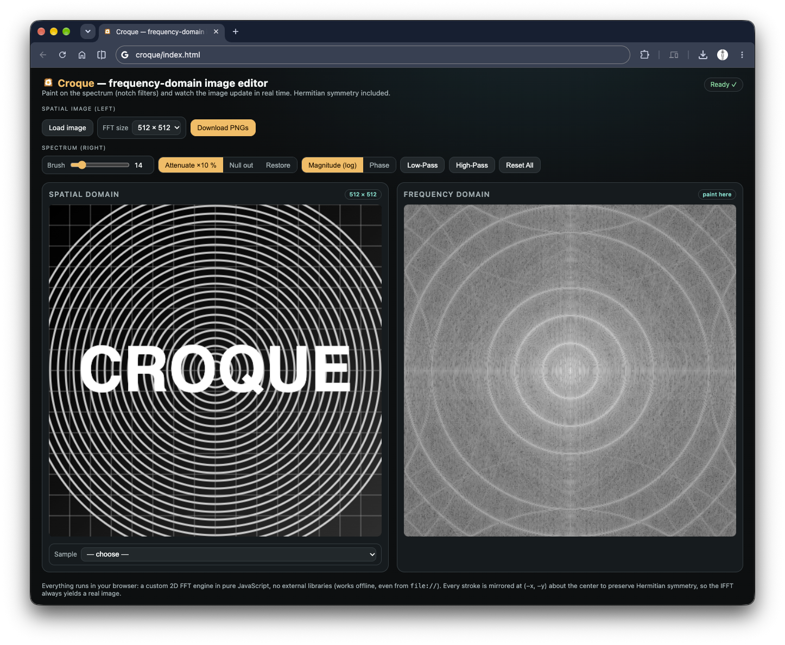
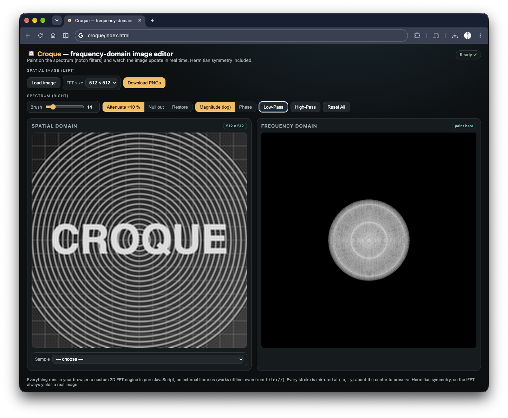
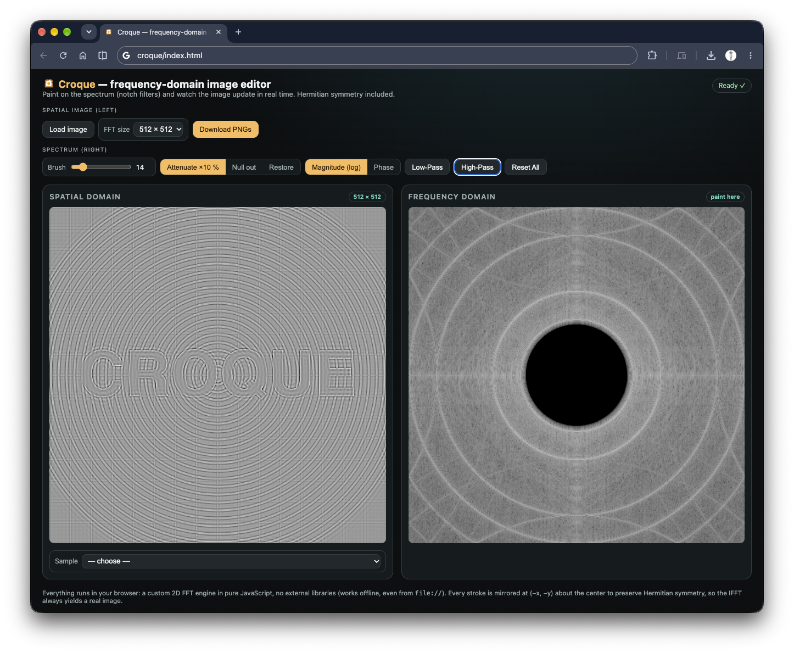
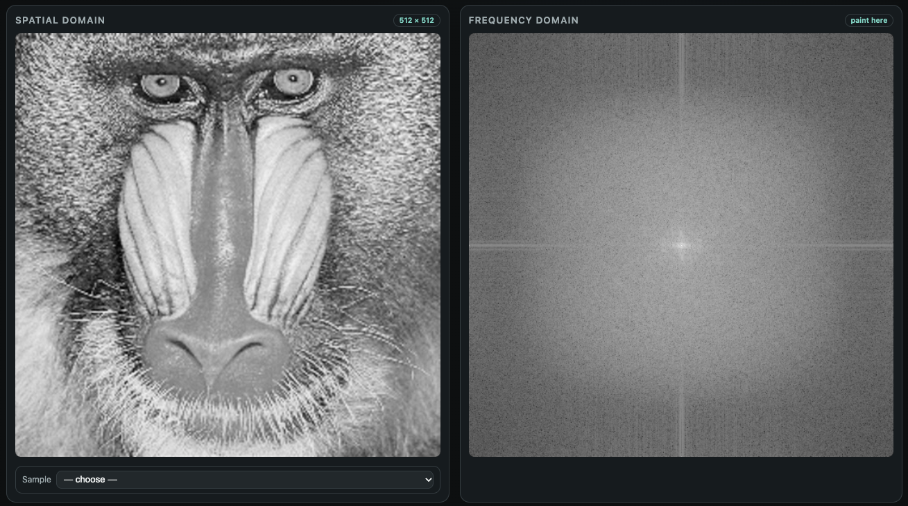
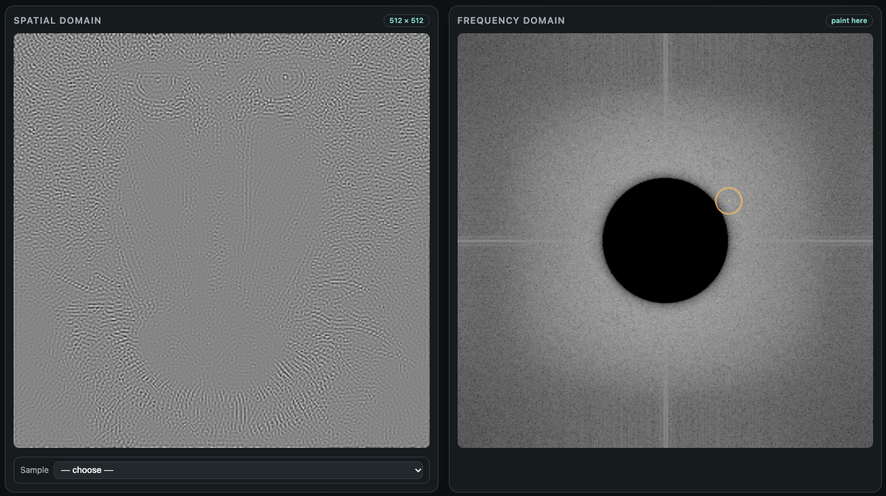

# Croque

[](LICENSE)
[](index.html)
[](index.html)
[](https://github.com/cuarentaysiete/croque/actions/workflows/test.yml)

A **frequency-domain** image editor for the browser: paint on the spectrum
(notch filters) and watch the image update in real time.

Single-file lightweight prototype — HTML, CSS and JS all embedded, no frameworks,
no build steps. Everything runs client-side with **HTML5 Canvas** and a **pure
JavaScript FFT engine** (no external libraries).

## How to use

Just open `index.html` in a modern browser (Chrome, Edge, Firefox, Safari).
Optionally serve the folder to avoid `file://` restrictions (needed for the
sample gallery):

```bash
npx serve .
# or
python3 -m http.server 8000
```

1. **Get an image in** any of three ways: the **Load image** button,
   **drag & drop** it anywhere on the page, or pick one from the **Sample**
   menu (bottom of the left panel — 12 classic test images from `samples/`).
2. **Paint** on the right canvas (spectrum): the cursor is a circle whose size
   matches the brush; each stroke is **automatically mirrored at
   `(−x, −y)`** about the center (Hermitian symmetry), so the IFFT always
   yields a real image.
3. Tune the **brush size**, pick the **action** (Attenuate ×10 % / Null out /
   Restore, as toggle buttons) and switch the view between **Magnitude (log)**
   and **Phase**.
4. **Low-Pass** / **High-Pass** presets (smooth cosine edge, no ringing),
   **Reset All**, and **Download PNGs** — saves *both* domains
   (`croque-spatial.png` + `croque-spectrum.png`).

Controls are grouped by what they affect: the left cluster works on the source
/spatial image, the right cluster on the spectrum.

## Screenshots


*The full interface with the built-in demo image: spatial domain (left) and centered log-magnitude spectrum (right).*

| Low-Pass preset | High-Pass preset |
|---|---|
|  |  |
| Smooth cosine mask keeps the central disc: the image blurs down to its low-frequency content. | Nulls the central disc: DC and shading are removed, leaving edges and texture. |

| Sample: Mandril | Notch painted next to the High-Pass hole |
|---|---|
|  |  |
| A classic test image from the Sample menu and its raw spectrum. | Brush work on the spectrum (note the circular brush cursor) after a High-Pass. |

## Pipeline

```
image → luminance N×N (power of two)
     → 2D FFT (pure-JS Cooley–Tukey)
     → fftshift (DC to center)
     → interactive editing (brush + presets)
     → ifftshift → 2D IFFT
     → 0..255 normalization → spatial canvas
```

The FFT resolution (128/256/512) is selectable. At 512×512 the IFFT is
recomputed every `requestAnimationFrame` (~40 ms each) to keep the feel
real-time.

## Design notes

- **Pure JS FFT** (radix-2 Cooley–Tukey with precomputed twiddles and
  bit-reversal permutation, reusable buffers): forward/inverse 512×512 in
  ~40 ms. No OpenCV.js — the public builds of that library don't ship the
  `dft`/`idft` module.
- **Hermitian symmetry**: every edit writes the conjugate value to the mirrored
  point `(N−x, N−y) mod N`, keeping the inverse transform strictly real.
- **Log-magnitude display**: `L = 1 + ln(1+|F|) / ln(1+max)`; the phase view
  is a grayscale of the raw phase.
- **Cosine filter edges** in the presets to reduce ringing (Gibbs) artifacts.
- **No server, no installation, no network** for the core: works offline, even
  from `file://` (only the sample gallery needs a local server).

## Files

| File | Description |
|---|---|
| `index.html` | Complete application (HTML + CSS + JS, self-contained FFT, zero dependencies) |
| `test/` | FFT engine test suite (Node, zero dependencies) |
| `.github/` | CI workflow: runs the test suite on every push and pull request |
| `samples/` | Classic test images for the Sample menu (Cameraman, Lena, Mandril, Peppers, …) |
| `docs/` | Screenshots used in the README (GUI, presets, sample sessions) |
| `icon.png` | App icon and default image |
| `icon.jpg` | Alternative example image (JPEG) |
| `LICENSE` | MIT |

## Testing

The FFT engine is validated by a dependency-free Node test that extracts the
exact engine code from `index.html`, so the tests always exercise what ships:

```bash
node test/fft-test.js
```

It checks five properties: the forward transform against a naive O(N²) DFT,
the inverse round-trip `IFFT(FFT(x)) = x` (including the 1/N² scaling),
Hermitian symmetry of the centered spectrum, a strictly real inverse output,
and 512×512 throughput. The same suite runs automatically on every push via
GitHub Actions (`.github/workflows/test.yml`).

## Limitations

- **Grayscale by design**: only the BT.601 luminance channel is transformed,
  so every edit is achromatic.
- **Power-of-two sizes only** (128 / 256 / 512), a requirement of the
  radix-2 engine.
- **float32 precision**: the inverse is real to within ~1e-5 relative error —
  invisible in the output, but not exact.
- **No undo history**: *Reset All* returns to the originally loaded image;
  there is no multi-step history.

## Development

Croque was designed by **cuarentaysiete** and implemented with the assistance
of an AI coding agent: the `pi` agent running a local Qwen3-27B (MLX) model.
The agent wrote the FFT engine, the interface, the test suite and most of this
documentation; the human steered the direction, reviewed every result and
pushed the commits.
